<p align="center">
  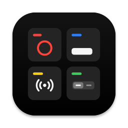
</p>

<h1 align="center">Tiles</h1>

<p align="center">
  <b>Camera control for the set, on iPad, iPhone and Mac.</b><br>
  Sony, Blackmagic and ARRI cinema cameras, over the network, a USB-C cable or Bluetooth.
</p>

<p align="center">
  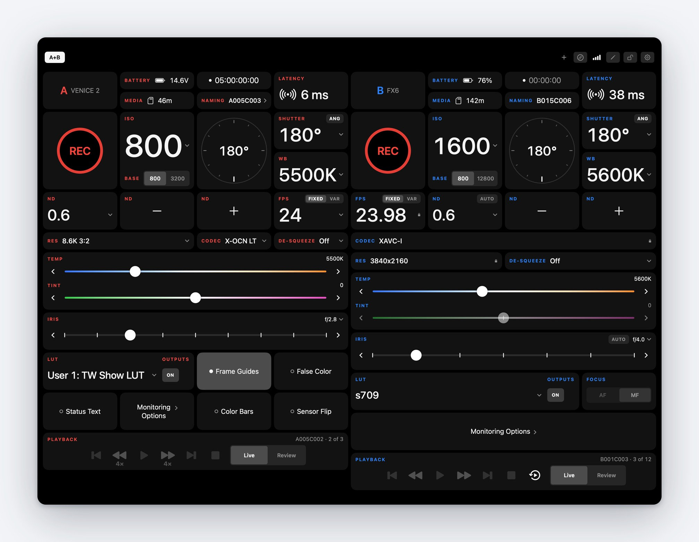
</p>

Tiles puts a camera's controls on a page of tiles you lay out yourself: exposure, REC with the camera's own
confirmation, LUTs and monitoring, playback and live view. A page can hold one camera or several, with REC, shutter,
frame rate and white balance linked across them. It's built for the links a set really has, a long mesh hop or a
busy Wi-Fi network as much as a cable: small requests, a latency readout on every page, and cameras that reconnect by
themselves.

Tiles is made by [Toldwell](https://toldwell.com) and is in beta. Support, terms and privacy:
[tiles.toldwell.com](https://tiles.toldwell.com).

## On set

<table>
  <tr>
    <td width="33%">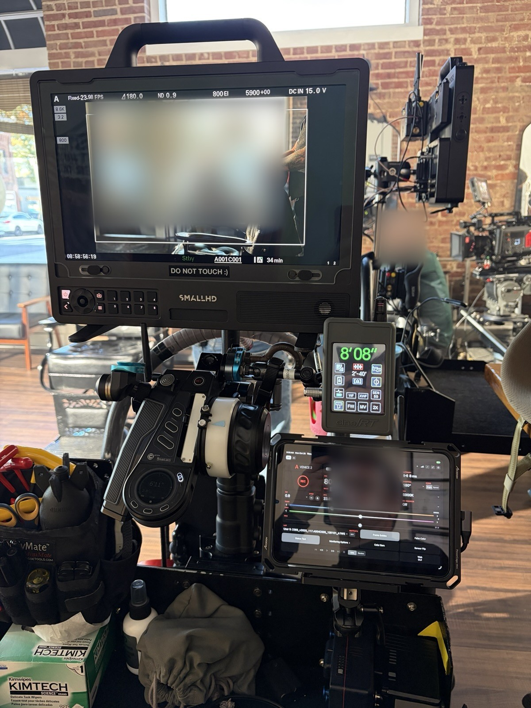</td>
    <td width="33%">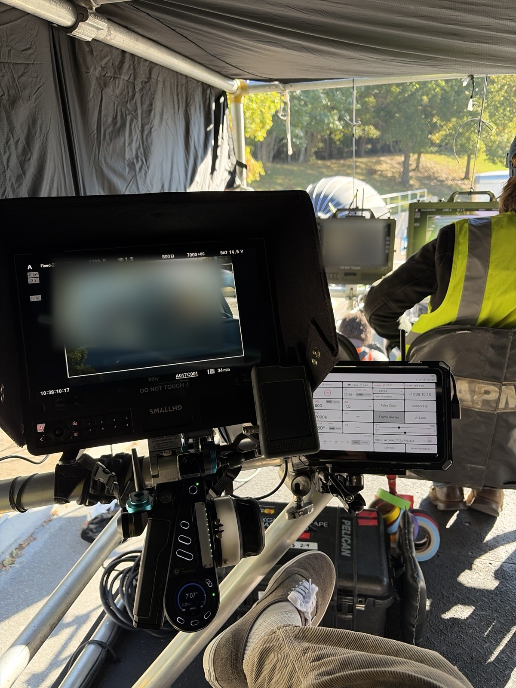</td>
    <td width="33%">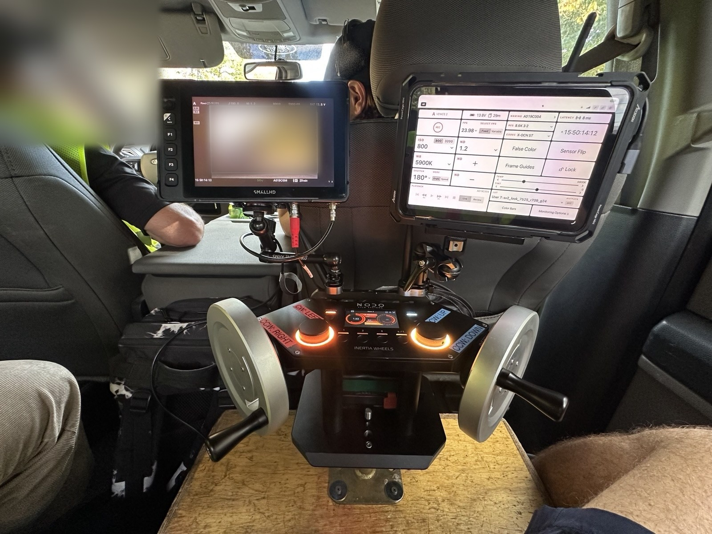</td>
  </tr>
</table>

<table>
  <tr>
    <td width="33%">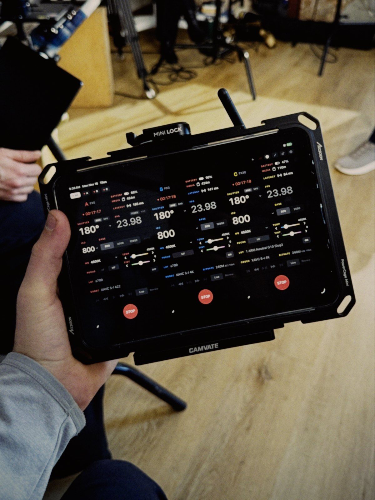</td>
    <td width="33%">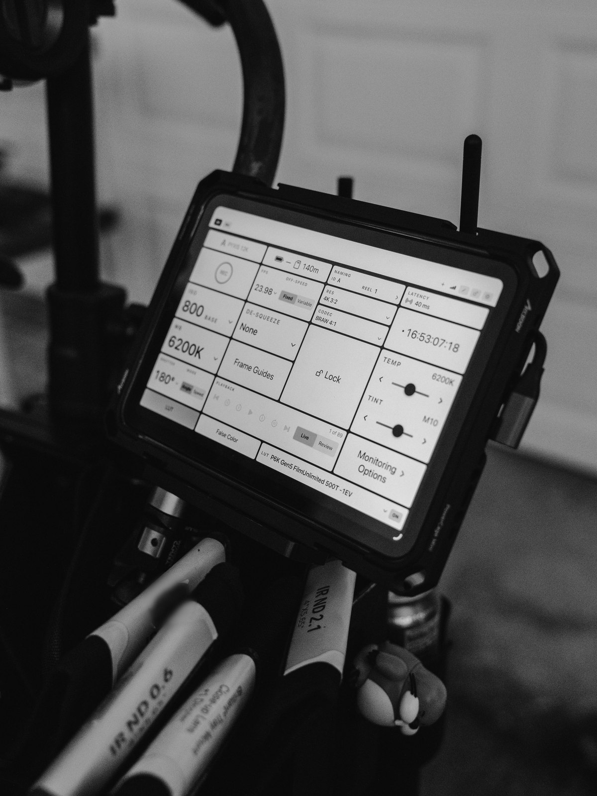</td>
    <td width="33%">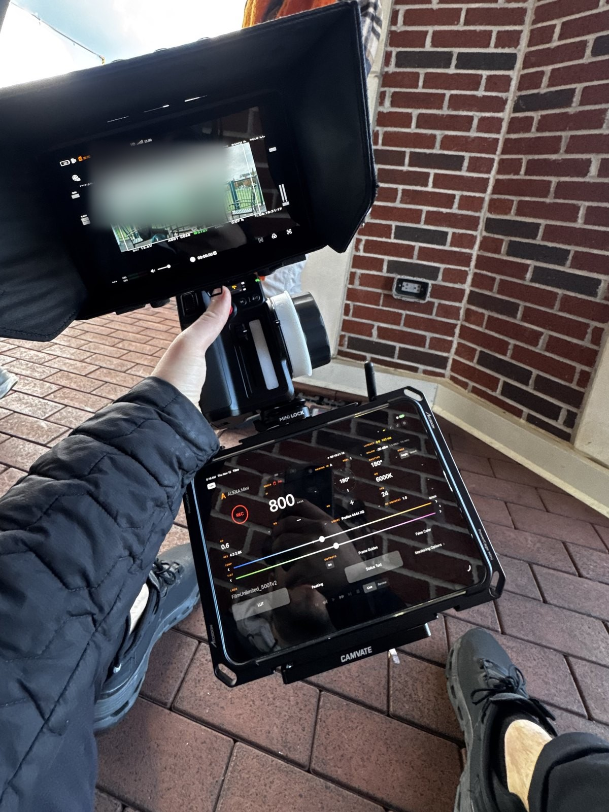</td>
  </tr>
</table>

## Cameras

| Camera | How Tiles talks to it | Checked on a camera |
|---|---|---|
| Sony FX3, FX3A, FX30, FX2, FX5, FX6 | Camera Remote (PTP-IP) over the network; over USB-C from a Mac, iPad or iPhone | FX3, FX30, FX5, FX6 |
| Sony BURANO | Camera Remote (PTP-IP) | Yes, over a Wi-Fi HaLow mesh |
| Sony VENICE, VENICE 2 | The camera's Web Remote | VENICE 2 |
| Blackmagic PYXIS 12K, URSA Cine | The camera's REST API, over the network or its USB-C port | PYXIS 12K |
| Blackmagic URSA Mini Pro 12K, Pocket cameras, PYXIS, URSA Cine | Bluetooth LE | Not yet: built from Blackmagic's protocol document |
| ARRI ALEXA Mini, Mini LF, ALEXA 35, AMIRA | The camera's Web Remote | ALEXA Mini, all but the iris (it needs a lens that reports it) |

Add Camera asks an address what it is and picks the way in; a camera on a cable is listed by itself. What each camera
offers, and how each was checked, is in `docs/` (one file per camera family).

## What it does

- **Exposure:** ISO or EI with the camera's base, shutter angle or speed, white balance presets with Kelvin and tint,
  iris and ND.
- **REC you can trust:** a tile only says recording once the camera does.
- **Monitoring:** LUT on and off and which LUT, false color, zebra, focus assist, frame guides and clean feed; on a
  Blackmagic camera, output by output. LUT import on Sony cameras.
- **Playback** with the same Live | Review switch on every camera.
- **Live view** on a tile or full screen: about one picture a second from a Sony camera over the network (about
  58 kbit/s), its own rate over USB; 24 fps from a Blackmagic camera.
- **Pages your way:** tiles in any arrangement, kept separately for portrait and landscape, a color per camera, and
  a look of your own in Settings → Appearance.
- **Demo cameras and Test Mode,** to lay pages out without a camera.
- **Wi-Fi HaLow links:** the signal, rate and retries of the HaLow nodes between you and the cameras, read-only, in
  the top bar.

<table>
  <tr>
    <td width="25%">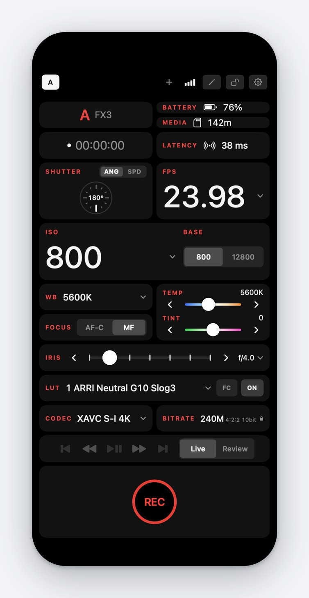</td>
    <td width="25%">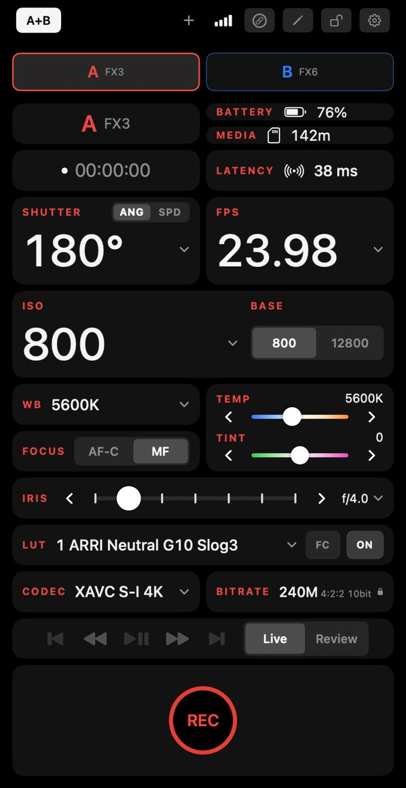</td>
    <td width="50%">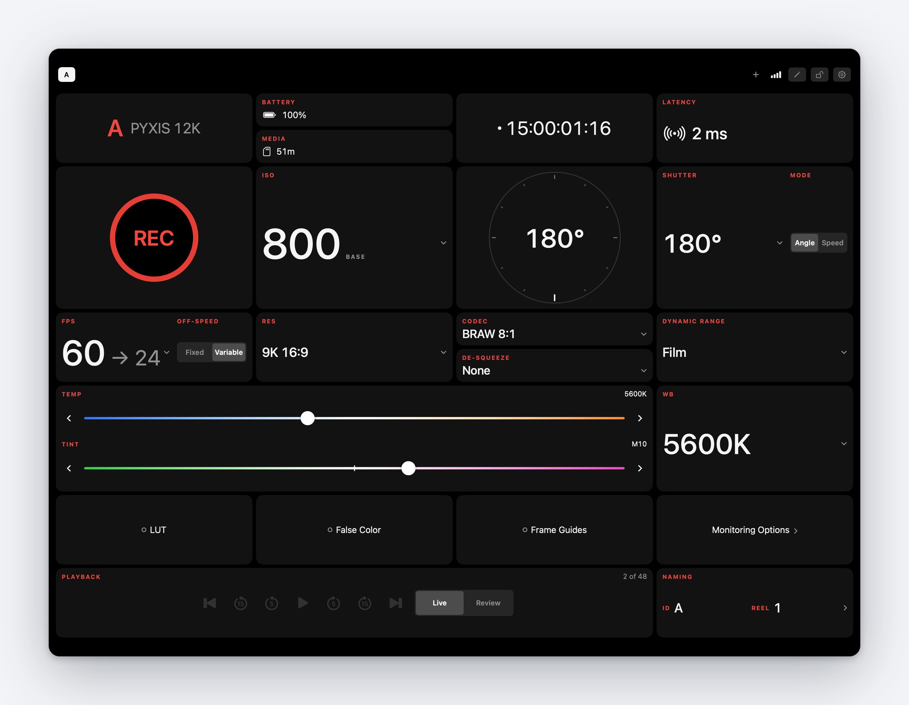<br><br>
      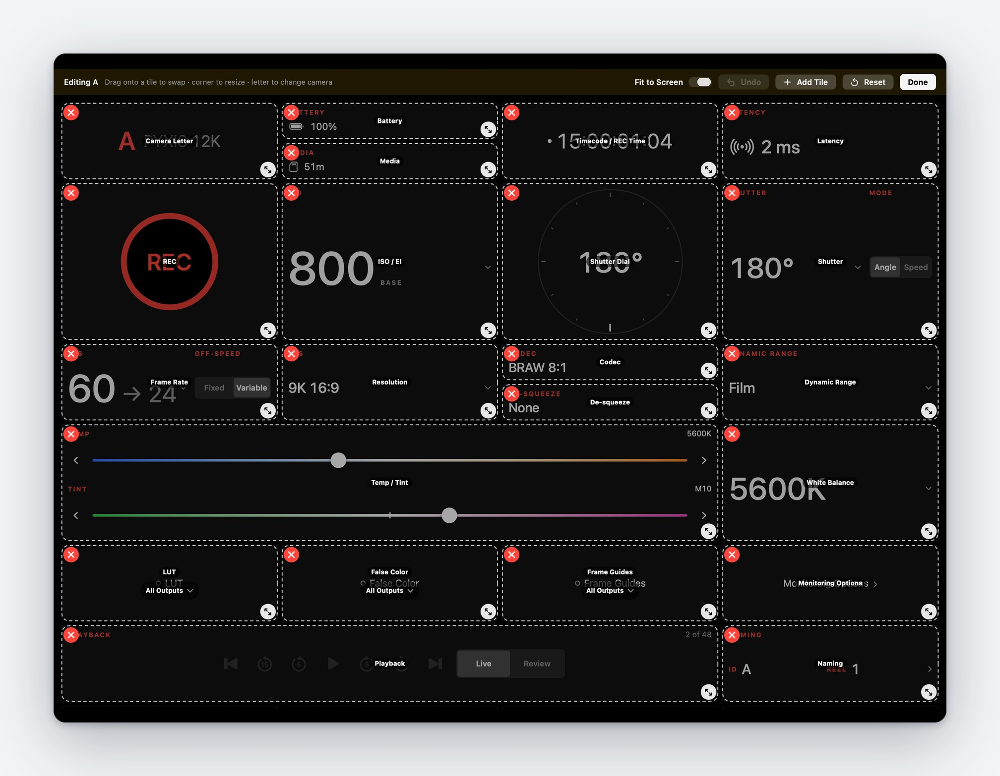</td>
  </tr>
</table>

## What Tiles never does

**It never formats, erases or initializes a camera's media.** There's no code for it anywhere in this repository:
not in the app, its Control API, a camera backend, the Stream Deck plugin, the Companion module or the tools in
`scripts/`. `NoMediaFormattingTests` reads every source file and fails on anything that reads like such a command,
and the tools' raw paths refuse any property, method or key whose name says format, erase or initialize. Over a
network link, that's a job for the person at the camera.

Two things pass a person's own presses through to a camera's own interface, so they reach whatever it offers, its
format page included, as standing at the camera would: the **Camera Menu** tile (a BURANO's or a VENICE's MENU,
arrows and Set) and the VENICE capture tool's `proxy` (the camera's own web page). Neither sends anything by itself.

## Stream Deck, Companion and scripts

Settings → Control API turns on a local WebSocket and HTTP server (ports 51800 and 51801, found over Bonjour, with a
token) that anything on the network can use to follow a camera's state and send it commands.

- [`docs/control-api.md`](docs/control-api.md): the protocol.
- [`integrations/streamdeck/`](integrations/streamdeck/): a Stream Deck plugin, with dials on a Stream Deck +.
- [`integrations/companion-module/`](integrations/companion-module/): a Bitfocus Companion module.

## Wi-Fi HaLow

On set, Tiles often reaches its cameras over a Wi-Fi HaLow mesh rather than Wi-Fi: Heltec's
[HT-HD01 V2](https://heltec.org/project/ht-hd01/) dongles. Each is a Morse Micro HaLow radio on the 902–928 MHz band
with an RJ45 port, a USB-C port that carries Ethernet and power (a Mac or iPad needs no driver for it) and 2.4 GHz
Wi-Fi of its own. A camera goes on one node's Ethernet, the iPad on another node's USB-C or Wi-Fi, and the mesh
carries the rest.

Tiles needs nothing from the nodes but a network, and installs nothing on them. With the nodes' admin password in
Settings → HaLow Nodes (`heltec.org` on a node as Heltec ships it), it can also show the link it controls cameras
through, its signal, rate and retries, in the top bar. It only reads ([`docs/halow-monitoring.md`](docs/halow-monitoring.md) has which nodes and how).

<p align="center">
  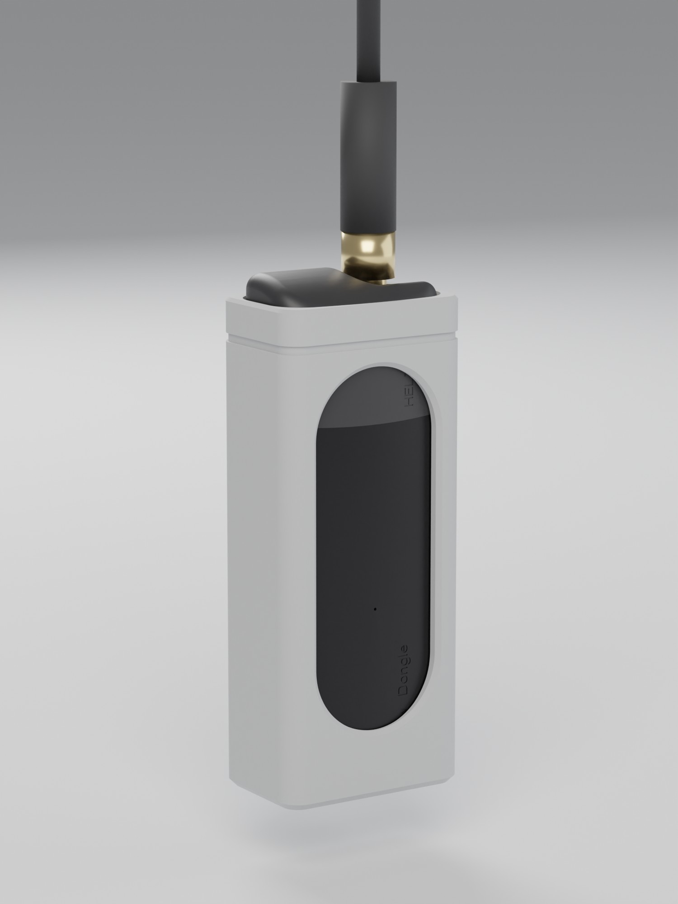
  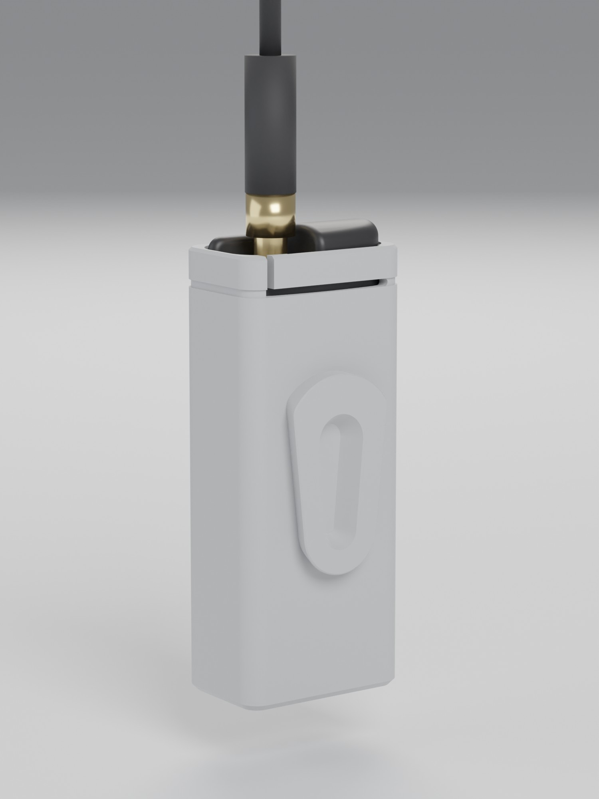
</p>

[`hardware/halow-node-cage/`](hardware/halow-node-cage/) is a printed cage for the HT-HD01 V2 that clicks into a
[Kondor Blue Mini Lock](https://kondorblue.com/products/new-mini-quick-release-plate) receiver on a rig: one part, no
screws or glue, every port open. Its Mini Lock wedge is measured from Ole S.'s
[Tentacle Sync E Clamp Kondor Blue Quick Lock](https://www.printables.com/model/1246022-tentacle-sync-e-clamp-kondor-blue-quick-lock),
so the files with the wedge are under his license, CC BY-NC 4.0. Thanks, Ole.

## Build it

You need a current Xcode (Tiles is built with Xcode 26) and [XcodeGen](https://github.com/yonaskolb/XcodeGen). Tiles
runs on iOS and iPadOS 17 and macOS 14 or later.

```sh
cd App && xcodegen generate && open CameraControl.xcodeproj
```

To run it on a device, put your own team ID in `TOLDWELL_TEAM_ID` in `App/project.yml`.

The camera code is a Swift package, `Packages/CameraKit`, which builds and tests on its own. Its tests run against
simulated cameras (`FakePTPIPCamera`, `FakeBlackmagicCamera` and others), so they need no hardware:

```sh
cd Packages/CameraKit && swift test
```

`camctl` drives a real camera from the command line with the app's own code, which is how most of what's in
`docs/` was measured:

```sh
cd Packages/CameraKit
swift run camctl dump 192.0.2.10                         # a Sony camera: every property it reports
swift run camctl bm 192.0.2.20 state                     # a Blackmagic camera, as its tiles would show it
swift run camctl usb                                     # cameras on this Mac's USB
```

`docs/testing.md` has the rest: Access Authentication, live view, the other cameras' commands.

## In this repository

`twcc`, Tiles' working name, survives in the Control API's `X-TWCC-Token` header and the Stream Deck plugin's ID,
neither of which can change without breaking what's installed.

| Path | What's there |
|---|---|
| `App/` | The app (SwiftUI), generated into an Xcode project by XcodeGen from `project.yml` |
| `Packages/CameraKit/` | The camera model, a backend per camera family, the dashboard UI, `camctl` and the tests |
| `integrations/` | The Stream Deck plugin and the Companion module |
| `docs/` | Architecture, how each camera family works and was checked, the field guide, the Control API |
| `fixtures/` | Recorded camera traffic the tests replay |
| `scripts/` | Tools for working with cameras and checking renders, and the one that makes the screenshots |
| `assets/` | The app icon's vector master and layers, the App Store screenshots, and a note on the false color LUTs |
| `hardware/` | A printed cage for the HaLow nodes |

Start with [`docs/architecture.md`](docs/architecture.md), and
[`docs/adding-a-backend.md`](docs/adding-a-backend.md) for another camera.
[`docs/field-guide.md`](docs/field-guide.md) is for people using Tiles on a set.

## License

Tiles' code is under the MIT license ([`LICENSE`](LICENSE)). [`NOTICE`](NOTICE) carries Sony's conditions, which
pass on to anyone who copies or uses Tiles with a Sony camera, and the notices of the open-source software Tiles is
built with. The app shows the same in Settings → About Tiles and asks for its Terms of Use once, before it connects to
a camera. The photos in `docs/images` are Toldwell's. The HaLow node cage in `hardware/` is under the MIT license too,
except its two files with the Mini Lock wedge, which are CC BY-NC 4.0 (its README says why).

Tiles is made by Toldwell, not by Sony, Blackmagic Design or ARRI, and none of them makes, endorses or supports it.
Their names are trademarks of their owners, used only to say which cameras Tiles works with.

Contributing: [`CONTRIBUTING.md`](CONTRIBUTING.md). Security: [`SECURITY.md`](SECURITY.md).
