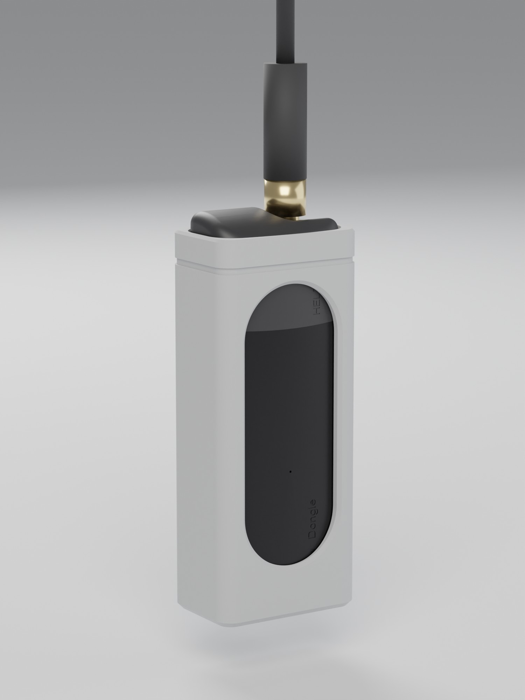
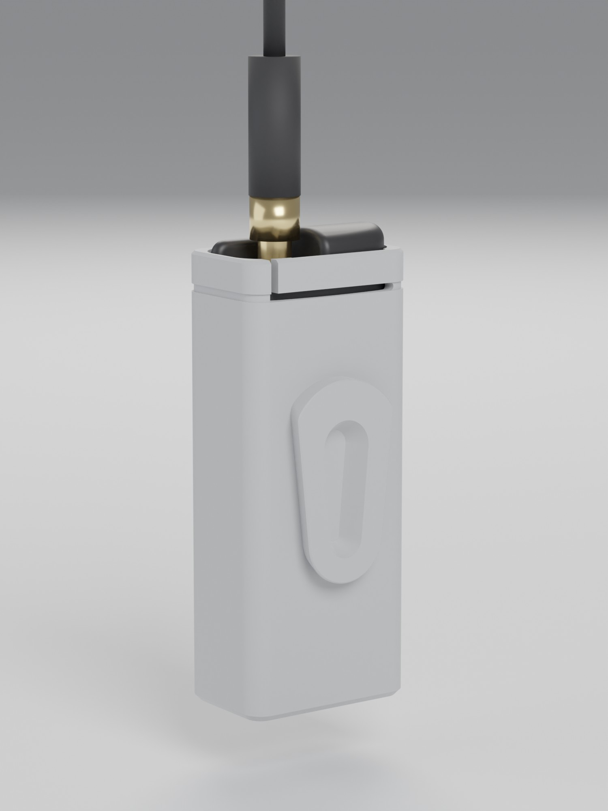
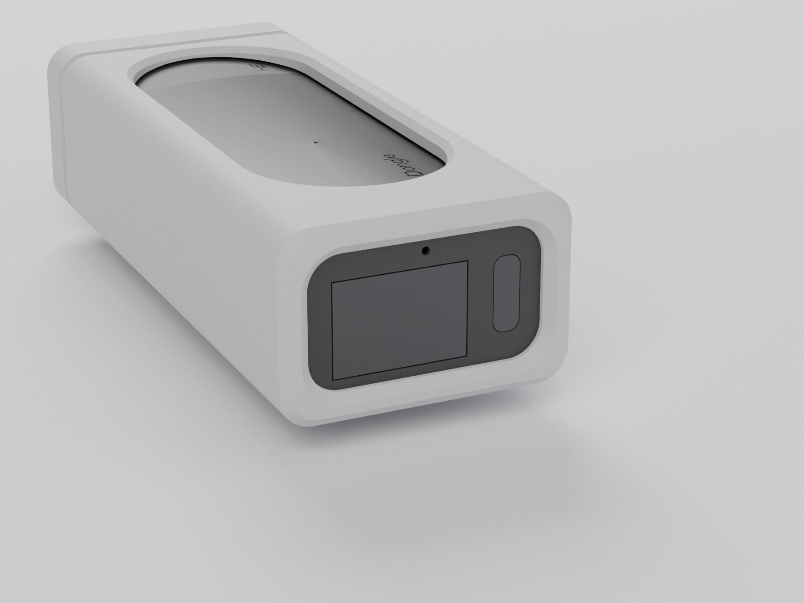

# HaLow node cage

A printed cage for Heltec's [HT-HD01 V2](https://heltec.org/project/ht-hd01/) Wi-Fi HaLow dongle that clicks into a
[Kondor Blue Mini Lock](https://kondorblue.com/products/new-mini-quick-release-plate) receiver on a camera rig. It's
one part, with no screws or glue. The radio keeps its aluminum housing as a heatsink, and every port stays open.

  
  
  

- **In use:** antenna up, cables down, LED facing out. It slides down into the receiver.
- **Radio in:** from the top, RJ45 end first and LED toward the window, until the latch clicks over the flat ledge
  beside the antenna connector.
- **Radio out:** push the latch back with a thumbnail, from the top beside the antenna, then push the radio up out of
  the bottom.
- **Size:** 36.6 × 85.2 × 28.0 mm with the wedge. The radio's top stands about 4 mm proud of the rim.

| File | |
|---|---|
| `hd01-cage_print.stl` | The cage with the Mini Lock wedge, as it prints: rim down, with a breakaway block under the wedge's rounded end |
| `hd01-cage-blank_print.stl` | The same cage with a plain back, for a radio that isn't on a Mini Lock |
| `hd01-cage.step` | The cage with the wedge in Heltec's CAD frame, for changing it |

## Printing

- **Material:** PLA, or ASA or PETG for a cage that will sit in a hot car (PLA softens at 55–60 °C). Not a
  carbon-filled filament: it's brittle, and it conducts.
- **Orientation:** rim on the bed, as the files are saved, with an 8 mm brim.
- **Supports off in the slicer.** The print file carries its own breakaway block, and a slicer's supports reach the bed
  through the open sleeve and fill it.
- **Settings:** 100% infill and 0.2 mm layers. The walls are 1.8 mm. Print one at a time, with a minimum layer time of
  about 8 s so the thin tower cools between layers.
- **Afterwards:** snap off the block, and cut the thin web across the latch's slit at the rim with a knife.

The sleeve clears the housing by 0.25 mm all round, as Heltec's CAD draws it.

## License

`hd01-cage-blank_print.stl` is under the repository's MIT license. The Mini Lock wedge on the other two files is
measured from Ole S.'s
[Tentacle Sync E Clamp Kondor Blue Quick Lock](https://www.printables.com/model/1246022-tentacle-sync-e-clamp-kondor-blue-quick-lock),
itself a remix of KSchloe's Tentacle SyncE Mount, so those two files are under his license,
[CC BY-NC 4.0](https://creativecommons.org/licenses/by-nc/4.0/): print them, share them and change them, but don't sell
them. Thanks, Ole.
